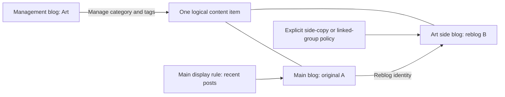

# Tumblr Studio: local web application and personal publishing design

Design date: 2026-11-06. Working product name; not a rename of the shipped extension.

**Functional workflow revision (2026-11-07):** [FUNCTIONAL_WORKFLOWS_SPEC.md](FUNCTIONAL_WORKFLOWS_SPEC.md) defines integrated original editing and interaction handling, capability validation and FW01–FW12. The user delegates technical presentation choices; home layout, publishing defaults and automation setup guesses were not confirmed. Runtime, business behaviour and complete workflows require separate evidence. An external link plus manual marking is transitional, not accepted integrated replying. Do not promise an unverified send transport or complete private messaging.

**Confirmed runtime revision (2026-11-07; pending implementation):** the user selected option 1: an independent local background service with an on-demand web interface in an ordinary browser. The purpose is to let Chrome fully exit between interactive sessions and reduce resident memory. [LOCAL_WEB_APP_SPEC.md](LOCAL_WEB_APP_SPEC.md) defines lifecycle, authentication, profile isolation, migration, resource measurement and LW01–LW18 acceptance. This supersedes requirements for a native desktop window, closing that window to a tray, and composing without a browser UI. Accepted jobs and core automation must continue without any browser, extension, Electron or embedded web renderer running. Existing feature requirements remain in scope; this update changes documentation only, with implementation assigned to Claude.

**Confirmed Chrome identities (2026-11-07):** profile1 is the user's daily work profile; profile10 is reserved for AI-agent testing. Explicitly route local UI launch, Tumblr links, OAuth/reconnect and optional companion/relay to the correct profile. Never use the active/default/last-used profile as a fallback. Verify actual profile-directory mappings before use. Work and test backends have separate data, credentials, sessions, callback correlation, ports and pairings; AI testing defaults to fake Tumblr and must not operate or close profile1. See LOCAL_WEB_APP_SPEC.md section 2.1 and LW15–LW18. A missing or unverifiable profile stops that browser step rather than crossing the boundary.

The historical filename and `desktop/` source path remain to preserve links. In current requirements, "application" means the local backend plus its browser interface; "application stopped" means the backend has stopped, not that a browser tab was closed. Historical implementation evidence below describes the Electron build unless a newer runtime acceptance result is explicitly recorded.

**Follower-management expansion (user request, 2026-11-07):** [FAN_RELATIONSHIP_SPEC.md](FAN_RELATIONSHIP_SPEC.md) designs one Fans & interactions module covering relationship follow-up, follower changes and the existing follower-protection functionality. All three areas and their integration are requested; the detailed UI, defaults and delivery phases are proposals. This is a design addition, not a claim that the expanded module is implemented. Protection execution and automation gates remain governed by [FOLLOWER_GUARD_SPEC.md](FOLLOWER_GUARD_SPEC.md).

**Confirmed product ownership (2026-11-06):** Tumblr Studio is the primary application; the extension is its browser companion. Each business capability has one owner in the application. Keep extension features only where browser/page access is necessary or makes an in-context action substantially more convenient. Section 4.3 supersedes the standalone extension manager and parallel automation design; a takeover toggle alone does not fulfil this requirement. This is a requirements update, not a claim that the migration is implemented.

**Confirmed reblog revision (2026-11-06, including the later tag clarification):** [REBLOG_POLICY.md](REBLOG_POLICY.md) governs all components. Reblog body, images, layout and content-version identity stay frozen. Owned-source reblogs synchronise original tags, including order, under the existing enabled policy; other-author/material reblogs keep creation-time tags. Content changes can produce a new version reblog; tag-only changes never do. Preserve submitted tag history separately from current observed tags. Visibility stays separate; older immutable-tag tests do not establish current acceptance.

> **Implementation status (2026-11-06):** stages 1–4 have code in [desktop/](../desktop/), not full product acceptance. Read [the status and acceptance gaps](DESKTOP_IMPLEMENTATION_STATUS.md) alongside [the implementation README](../desktop/README.md). Implementation choices do not silently waive confirmed requirements; label preservation, mutation ownership and uncertain-create recovery remain open gates.

This is the local application's requirements and acceptance contract. Implemented, blocked and deferred capabilities are tracked separately in the status document. [SPEC.md](SPEC.md) remains the historical extension specification. This document takes precedence for the local application where the two disagree. Read [PRODUCT_WORKFLOWS_ZH.md](PRODUCT_WORKFLOWS_ZH.md) for user-facing flows, [FOLLOWER_GUARD_SPEC.md](FOLLOWER_GUARD_SPEC.md) for follower protection, and [STAGE0_RESULTS.md](STAGE0_RESULTS.md) for completed adapter probes and outstanding gaps. Probe results are not acceptance of the complete application or its new runtime. Confirmed requirements remain distinct from implementation proposals and configurable preferences.

**Confirmed requirements:** a local application with an on-demand browser interface, an independent background service whose accepted publishing jobs and routine automation continue with the browser fully exited, and an optional companion browser extension; a personal sharing experience; bulk visibility changes; age-based hiding with manual exceptions; tag exclusions for automatic reblogs; general category tags before template tags; a reliable Tumblr-compatible visual composer with optional Markdown conveniences; AI-assisted protection from spam followers; and side-blog management of main-blog posts reblogged into a side blog. The user explicitly deferred the unusual case of two side blogs managing the same main-blog post.

**Confirmed in the resumed discussion (2026-11-06):** prioritise local writing, management and browsing. Age-based hiding reduces the accumulation of old posts on the blog homepage and must support hiding the user's original posts, including main-blog originals managed from a side blog. It is triggered only by publication age, not by creation of a reblog. The user may manually keep popular posts public; this is a durable exception, not an automatic popularity threshold. A public-theme redesign is not a first-release requirement.

**Subsequent product feedback:** confirmed process/unfinished-work sharing, separate topic/category dimensions, remembered publishing choices, quiet automation, low-burden follower protection, and long-term backup/migration. The editor's concrete pain point is buggy drag-based image arrangement in Tumblr. Reliable image placement and reordering without mandatory dragging are acceptance requirements; Markdown remains a writing preference rather than the sole product objective. The user has not considered a separate capture-now/publish-later product or a followed-blog reading feed; neither is first-release scope. Material-library expansion is deferred. Translation/writing-language assistance is excluded. Basic editor autosave and preservation of existing imported data remain necessary. See the numbered feedback record in PRODUCT_WORKFLOWS_ZH.md; unaddressed guesses are not confirmed.

**Latest editor clarification (supersedes earlier Markdown-first assumptions):** the user accepts Tumblr-supported arrangements generally and does not require a pure Markdown editor. The actual requirement is a usable alternative to the buggy official composer. Use a visual block editor and a structured document as the primary editing/storage model. Markdown is optional input/import/export convenience and cannot limit native content/layout support. Do not ask the user to choose a single image arrangement before implementing normal supported layout operations.

**Proposed defaults:** Windows first, one Tumblr account with its blogs, the navigation, timing, storage model, and release sequence below. They are design choices, not additional user-confirmed requirements. No cloud service operated by this project is required.

**Research boundary:** the previous session reviewed the repository and official documentation but could not connect to the browser. In the resumed session, user-authorised Playwright access successfully inspected the signed-in blog menus and sample posts. Observations included side-blog originals reblogged to main, main-blog originals reblogged into another side blog, a pinned profile post, category-first `diary` tags on illustrated process posts, and reference reblogs with palette tags and AI notes. Some owned reblog instances were visibly private. No post, visibility, follower, block, or report was changed. Sampling is not a complete account audit or a capability test. Examples in this document remain anonymised; blog identifiers and private-post contents are not included.

**Subsequent evidence:** the read-only boundary above describes the design session. A later implementation-side stage 0 ran controlled adapter probes and reports cleanup of its test posts in STAGE0_RESULTS.md. This revision incorporates that report without rerunning account operations. A38's exploratory requirement has been withdrawn; established reblog semantics are inputs, not reasons to repeat live posting experiments.

**Configurable preferences:** original/reblog expiry scope is designed as independent-blog or linked-group mode, explicitly selected before activation. This supports either preference without blocking implementation or assuming a permanent public side-blog archive. Blog roles and follower operating modes are likewise explicit setup choices. Full offline archiving of existing remote posts and original media remains optional future scope; durable storage of newly written drafts and attachments is part of the proposed foundation.

## 1. Product position

A personal publishing desk for Tumblr: write diaries and illustrated posts, organise them by topic, decide what stays on public display, and maintain a quieter audience. The local web interface is the daily workspace, opened only when needed; its independent backend owns data and automation. Tumblr supplies hosting, distribution and social interactions.

The intended experience borrows the image cards and category browsing of a personal sharing platform, with a chronological timeline for text-heavy entries. The core loop is:

1. Compose visually and arrange images locally, with optional Markdown input conveniences.
2. Choose a general category, then optional fandom templates.
3. Preview the content, final tag order, destination and display policy.
4. Publish, then manage the work from its management blog.
5. Let explicit rules maintain display duration, reblog routing and follower protection.

There are two distinct presentation surfaces:

| Surface | First-release requirement |
|---|---|
| Local web personal home | Image cards / chronological timeline, category tabs, draft continuation, published and hidden content, management-blog navigation |
| Public Tumblr blog | Real Tumblr posts with consistent category tags and intentional visibility; existing Tumblr URLs and attribution are retained |

A matching public Tumblr theme is outside the confirmed first-release scope and may be discussed later. The local interface does not change the Tumblr dashboard or mobile app for visitors. Theme-only filtering must never implement hiding: the remote post's visibility must actually change. Do not add a separate social network, friends-only audience system, recommendation engine or public hosting service to this release.

## 2. What changes from the existing project

The reviewed working tree reports version 0.9.5. It already contains user changes; preserve those during implementation.

| Existing design / implementation | Local application decision |
|---|---|
| Chrome MV3 manager page; session requests through `www.tumblr.com/api` | Local web interface, direct authenticated backend Tumblr adapter, optional browser companion |
| Electron window hosting the local interface and service | Reuse the UI and business logic; move service ownership into an independent backend and replace Electron-specific adapters |
| Manager-tab jobs and `chrome.alarms` background passes | One durable local job service, independent of any window or browser tab |
| `autoRecent`: image posts, fixed day presets, `recentHidden`, automatic restoration when disabled | All eligible content types; custom days; persistent exceptions; explicit restoration workflow |
| `copyKeys` / `syncCopies`: original controls copies; copies cannot be selected | Logical groups with frozen reblog bodies; dedicated owned-source tag sync, versions and visibility are separate operations |
| `autoMaintain`: new sharing-side-blog posts reblogged to main | Explicit routes delivering new source revisions as new reblogs, with exclusions and per-version deduplication |
| `sortTagsFair`: work / characters / relations before other tags | General categories form a fixed prefix; template ordering runs only within its segment |
| Native Tumblr composition | Reliable local visual composition, structured drafts and attachments, Tumblr-compatible preview/publishing, optional Markdown input |
| Material collection, packs, tag cleanup, AI image sorting, browser helpers | App owns management, data and jobs; extension retains browser helpers and contextual entry points only. Preserve existing data during migration; no material-library expansion is implied |
| No follower-protection subsystem | New follower inbox, evidence-based classification, allowlist, blocking and capability-gated reporting |

Relevant implementation references: [core](../src/core.js), [background](../extension/background.js), [companion](../extension/companion.js), and [extension manifest](../extension/manifest.json). Reuse the pure tagging and pack logic where suitable. Keep business execution in the independent local backend; moving it back into a manager tab or extension would restore the browser-session dependency and the wrong management authority.

## 3. Original location, management blog and display instances

### 3.1 The three concepts

| Concept | Meaning | Example |
|---|---|---|
| Original location | The blog and post that actually originated the content on Tumblr | Main blog's original post A |
| Management blog | The user's organisational home for this logical work | Art side blog |
| Display instance | An original or reblog of that work on one of the user's blogs | Main/A and Art/B |

Changing management never changes authorship, recreates an original post, changes its permalink, or rewrites the Tumblr reblog trail. Group membership must come from actual reblog identities, not similar text, images or tags.

**Platform baseline:** an existing reblog is a separate post managed by its reblogging blog, retaining the content it reblogged. Editing, deleting or hiding the original does not update or withdraw that existing reblog. The [official reblog help](https://help.tumblr.com/reblogs/) explicitly documents edit/delete independence; the user's clarification and stage-0 record also cover hiding. This is a design input, not an exploratory test gate. A local content group is an organisational link, never a live content reference whose children inherit every original change.

The application preserves each reblog's historical body, images and layout. Direct batch tag edits target originals; dedicated owned-source tag sync may subsequently update their owned reblogs' tags and order without changing content versions. Other-author/material tags stay fixed. Content changes create a new observed revision and, under enabled routes or explicit action, a new reblog; tag-only changes do neither. Visibility preserves the selected instance's current payload. Never substitute the latest original body for an old snapshot or delete/recreate it to simulate sync.

### 3.2 Assignment rules

1. An original posted on a sharing side blog is managed by that side blog. Reblogging it onto main does not transfer management to main.
2. An original posted on main initially belongs to main. Once exactly one of the user's **sharing** side blogs reblogs it, that side blog becomes its management blog. This is the newly requested behaviour.
3. Apply the same classification to historical posts after their relationships are synchronised. It is not restricted to posts made by this application.
4. Material blogs never take management authority merely by collecting a post. Unclassified blogs are not eligible for automatic assignment.
5. A reblog of somebody else's work is also a frozen snapshot: choose tags/commentary before creation, then preserve them. The app cannot edit the other author's original. Later local analysis must not rewrite the remote snapshot.
6. If a main-blog original has two eligible sharing-side-blog candidates, set `management_status = ambiguous`. Leave existing posts as they are and pause automatic group edits and routing for that group. Manual operations on explicitly selected instances remain available. Do not implement first-wins, last-wins or joint management in this release; the user said to leave this case alone for now.
7. A missing/deleted management reblog or a role change makes the relationship `needs_review`. Do not silently transfer authority back to main or recreate the reblog.

Assignment itself is local organisation; it neither overwrites remote fields nor schedules a new reblog. Reconciliation preserves historical differences. Only explicit original edits, selected display policies and enabled version-delivery routes authorise their respective remote operations.

Management is counted by distinct eligible blogs, not reblog count. Multiple revisions in the same side blog yield one manager. Historical body differences never become repair jobs; owned-source tag sync is governed separately by REBLOG_POLICY.md.

### 3.3 What the management blog controls

- The content item appears in the side blog's **Managed here / 归我管理** view, even if its actual original is on main. Main's **Displayed here / 在此展示** view still contains its original, labelled with the management blog.
- Category and template selections apply to the actual writable original and future plans. Existing owned-source reblogs subsequently receive tags through dedicated sync, not direct batch selection; their bodies stay fixed. Tag-only changes never schedule another reblog.
- Management assignment alone authorises no remote writes. Show observed tags and pending sync separately. Owned-source tag updates follow REBLOG_POLICY.md; other-author/material tags never become repair targets.
- Text editing routes to the actual writable original when it is the user's own original. A reblog's added commentary is frozen with that snapshot. Moving management does not turn its caption into the original body.
- Each display instance keeps its own observed remote state and manual display policy. Section 7 defines independent-blog and linked-group expiry configurations; the user has not chosen a personal default. Do not assume side blogs keep a permanent public archive. Never use a reblog's current `private`/`published` state as an instruction to overwrite the whole group.
- For visibility only, the management screen offers **Apply to all my linked posts**, listing the exact versions and instances. Body/tag edits cannot use this action to rewrite existing reblogs. Each instance can have a separate display policy.
- Keep creation-time submitted tags as history and current observed tags separately. Owned-source tags may synchronise; disabling routes does not itself rewrite posts or enable another policy.

Remove generic copy/body drift repair. Reblogs can be selected for visibility; direct batch body/tag edits target originals. Dedicated owned-source tag sync is the bounded exception for tags, never bodies.

## 4. Local web runtime and browser companion

### 4.1 Runtime contract

The browser interface is needed for interactive composition and management. After the backend has durably accepted work, the browser may be completely terminated: supported publication, post synchronisation, tag/visibility jobs, reblogs and permitted follower actions must continue through the independent backend. Existing capability and authorisation gates still apply. Browser-independent execution is a release gate, not a fallback mode; interactive composition with every browser terminated is no longer required. See [LOCAL_WEB_APP_SPEC.md](LOCAL_WEB_APP_SPEC.md) for the full runtime and migration contract.

| Situation | Behaviour |
|---|---|
| Backend running, local page open, online | Compose/manage in the browser; the backend owns storage, credentials and execution |
| Local page closed or every browser process exited | Accepted jobs and enabled automation continue through the official API adapter; no hidden browser/renderer is retained or reopened |
| Backend explicitly stopped, PC asleep or powered off | Local scans and edits stop; resume and reconcile on the next start. Closing a browser tab is not this action |
| Offline, backend running | Local UI assets, cached content and draft saving remain usable; remote operations wait visibly |
| Authorisation expired or revoked | Save local work; pause affected remote tasks and show Reconnect |
| Browser-only capability unavailable | Show the specific limitation; never call an unperformed operation successful |
| Multiple tabs or repeated launcher activation in one environment | Reuse that environment's backend and mutation queue; detect stale draft revisions, never start another scheduler or attach the isolated test environment to the work backend |

Already submitted Tumblr queue/scheduled posts are separate from local jobs. Their server-side publication does not depend on the local backend running. Local expiry and follower checks do. Backend-confirmed drafts, attachments and jobs survive closing the browser; unacknowledged browser input must not be presented as saved or accepted.

Proposed schedule: every 10 minutes while the local backend runs, plus startup/network recovery and relevant rule changes. Show last success, backlog, coverage and next attempt. No claim of exact-to-the-second hiding while a computer is offline. Launch at Windows sign-in is optional and off initially; when enabled, start only the backend. Provide everyday launch, Open interface, Pause automation and Stop backend controls without requiring a terminal. Browser exit must not be implemented by hiding an Electron/WebView window. Record comparable old/new memory and idle-CPU evidence under LOCAL_WEB_APP_SPEC.md section 6; no unmeasured MB target or saving is claimed.

### 4.2 Authentication and capability validation

Use the documented Tumblr OAuth API for core operations. [STAGE0_RESULTS.md](STAGE0_RESULTS.md) reports browser-exited passes for authorisation/refresh, blog and post reads/pagination, NPF image creation/full editing, visibility changes, reblogging, deletion, follower/following and block-list reads. Block/unblock, community-label preservation and legacy editing remain unverified. API reporting is unsupported in the validated adapter. Continue stage 1 with these explicit gaps; do not rerun passed probes merely to restate platform behaviour. [Official API documentation](https://github.com/tumblr/docs/blob/master/api.md)

Stage 0 validated user-owned application credentials and a loopback callback. Do not bundle a shared secret into a publicly distributed client or assume an undocumented secretless flow. Use the operating-system credential store; browser cookies, web-client tokens and AI keys do not belong in ordinary exports or logs. [OAuth documentation](https://github.com/tumblr/docs/blob/master/api.md#oauth2-authorization)

OAuth credentials and refresh execution belong to the backend, independently of the local browser's access session or Tumblr website cookies. Closing/reopening the assigned profile or clearing local site data must not erase that environment's backend drafts/data or invalidate otherwise valid Tumblr credentials. Tests may clear only the test instance's site data in profile10. Work/test access credentials and OAuth callbacks must be bound to their initiating backend/request and cannot cross environments. Replace Electron-specific credential protection with an equivalent local adapter, not plaintext storage. Serve the local interface and APIs only on loopback with Host/Origin/session checks and cross-site request protection; the ordinary browser gets no privileged IPC, arbitrary filesystem/shell access or backend secrets. File/media/backup flows need explicit browser-compatible adapters, as defined in LOCAL_WEB_APP_SPEC.md sections 3–5.

Refresh tokens rotate on every refresh in the validated adapter. Use one refresh writer per account and atomically replace the encrypted credential record containing both tokens, expiry and generation before dependent requests use the new generation. Read expiry from the response. A failed local commit stops dependent work. Atomic local replacement does not make server refresh plus local persistence one transaction: a lost response/crash before durable receipt may require reconnection; do not blindly replay a possibly consumed refresh token. Test these recovery paths with injected failures and fixtures.

Record capabilities per adapter/account/blog: supported, unsupported, unverified, authentication required. Verify the writable fields on representative posts, especially older formats, labels and reblog controls. A browser fallback for an advanced unsupported operation is explicit. It cannot be used to claim that browser-independent core operation passed.

### 4.3 Companion responsibilities

The local application (backend plus browser UI) is the product; the extension is an optional accessory, not a second management client. The local UI and supported core jobs must work without the extension installed. A feature stays in the extension only when it needs the current webpage/browser or benefits materially from an in-context shortcut. Reusing a shared tag picker in Tumblr's editor is useful page integration; duplicating pack administration, classification settings, jobs or logs is not. Open in Studio and management links now open the relevant local web page; the backend, not any open page, remains the owner of requests and results.

| Capability | Application responsibility | Extension responsibility |
|---|---|---|
| Writing and publishing | Full composer, draft storage, preview, publishing and recovery | Optional suggestions/template insertion into Tumblr's already open editor; no second composer or local publishing queue |
| Post management | Browse/search/filter, management ownership, versions, batch tags/visibility and expiry | Show current-post context and Open in Studio; no full manager or extra batch-edit controls |
| Categories, templates and tag library | Define/edit/import/update groups, packs and rules; maintain authoritative library and statistics | Read app-provided data for inline suggestions/picking; settings links open the app, not another administration screen |
| Reblogging and automation | Version detection, routes, exclusions, deduplication, scheduling and all durable jobs | Send selected post identity/context to the app; no independent sync/reblog/expiry/collection alarms |
| Follower protection and AI | Evidence, decisions, provider settings/credentials, allowlist, block/unblock, review and reporting state | Navigate/assist the genuine Tumblr-only report UI when needed; no second classifier, follower inbox or AI executor |
| Existing collection/material tools | Own retained functionality and its local analysis/jobs under the immutable-reblog policy | Contextual Send to Studio / Analyse in Studio entry point only; no standalone collection dashboard or AI write path |
| Tumblr browsing | Own shared preferences and any shared analysis results | Hide ads/recommendations, local page filtering, tag/search hints and enhancements to existing page controls |
| Data, connection and status | Authoritative settings, backups/import, activity and task state | Pairing/connection status, permission prompts, small page-only controls, one-time legacy export and links into the app |

Tumblr's own editor/publish controls remain Tumblr's; inserting tags into an unsent page editor is not an extension-owned remote write. Do not add a duplicate workflow merely because it could technically run inside a browser. Browser convenience entry points that start app work submit a typed request with stable identity; the app owns its preview, approval scope, execution and result. Avoid two confirmation flows for one action. The extension may display a concise acknowledgement/status from that same job, not run or record a second job.

The application owns categories, packs, blog roles, route policies, AI configuration and durable activity. The extension may cache versioned, read-only snapshots for page assistance, showing unavailable/stale state where relevant; it must not keep separately editable copies or refresh an independent account-wide library. A small browser-only preference control is acceptable if its scope is explicit and it does not duplicate the app's settings model.

When the backend is stopped or disconnected, browser-local helpers can continue and cached suggestions remain usable. App-dependent actions show Start/Connect Studio and cannot claim to be queued until the backend durably acknowledges them. Merely closing the local UI does not make a running backend unavailable. Do not introduce a second persistent extension business queue or silently resume standalone manager/automation. A browser-only remote action is an explicit, validated adapter for an app-owned operation, with one operation ID and its receipt/uncertainty reported to the app; it is not a general fallback for core API writes. Native user actions in Tumblr remain outside the app's executor.

Current delivery still has the legacy manager, export/import and a takeover guard; it is not the target companion. The recorded write guard is useful migration protection but does not remove duplicated screens, data ownership or algorithms. The live bridge and full companion acceptance remain pending. Final product behaviour must not offer a toggle to restore an independent plugin manager/scheduler.

For migration, prefer adapting the existing paired loopback bridge to the independent backend; a Native Messaging connector remains an implementation alternative, not a required desktop host. Keep extension pairing separate from the local web session and validate permitted callers. Pair work-profile1 and test-profile10 installations independently with their respective backend; an extension ID or a self-reported profile name alone does not prove the correct installation. Neither an extension worker, connector nor browser page owns the scheduler. Optional relay can use only its already open, explicitly paired profile. If profile1 is closed while profile10 is online, work tasks use the official API or wait according to capability, never borrowing the test session. Loss of the intended session does not justify keeping or opening a browser. An uncertain write is reconciled before any fallback resend.

The bridge must check protocol version, paired account/blog identities and operation IDs. It must not accept arbitrary URLs to fetch, shell commands, arbitrary file paths or page-supplied code. The local web UI and imported post content are not privileged execution contexts. Keep credentials in the backend connection layer. A normal installation handles any required connector setup; end users should not need developer tools for daily use.

### 4.4 Manual AI connection settings

Confirmed again on 2026-11-07: CC Switch support is not needed. Keep manually entered API address, model and locally protected key in application Settings. Do not read CC Switch or start local AI clients. A57 is withdrawn, not an outstanding task. Verify required endpoint capabilities explicitly; the companion has no separate AI configuration or credentials.

## 5. Information architecture

**Content-page usability revision (2026-11-07):** the user finds the Posts page awkward and its “Categories & tags” filter inadequate. [CONTENT_BROWSER_UX_SPEC.md](CONTENT_BROWSER_UX_SPEC.md) records the observed interface/source problems, proposed layout and interaction rules, delivery priorities and CU01–CU20 acceptance scenarios for Claude. It is a requirements/design handoff, not implemented behaviour. The proposal separates work/physical-post scope, visible composable filters, selection and batch actions; it also defines query/scroll restoration, exact-instance details and local sync coverage. Detailed defaults are design recommendations, distinct from the user's confirmed request to improve usability.

**Version maintenance requirement (2026-11-06):** the application provides a single “Versions and reblogs / 版本与转发” view per work, reachable from its card or any instance. Implement REBLOG_POLICY.md section 2.1 and R12–R17: per-version/per-blog history, explicit source-versus-delivery status, snapshot comparison, scoped batch visibility/deletion, local notes and controlled delivery recovery. A version list alone is not complete maintenance. A one-off “keep latest public reblog, hide older public reblogs” preview respects Keep visible, unknown outcomes and per-blog delivery; it must not introduce automatic old-version cleanup or republish a private version. The companion only opens this app-owned view.

| Area | Primary content and action |
|---|---|
| Home / 我的主页 | Avatar/profile, category tabs, recent cards or timeline, Continue writing, New post |
| Write / 写作 | Visual text/media blocks, image arrangement, publication preview, category, templates and destination |
| Posts / 内容 | Managed here / Displayed here; public, hidden, drafts, Tumblr queue; bulk actions |
| Rules / 自动规则 | Display duration, reblog routes, exclusions, exceptions, next-run preview |
| Followers / 新关注 | New, review, blocked, report pending, allowlist; reasons and corrections |
| Tags & templates / 分类与模板 | General categories first, existing fandom packs second, maintenance tools |
| Activity / 活动记录 | Persistent task progress, failures, uncertain outcomes and recovery |
| Settings / 设置 | Tumblr connection, companion status, blog roles, data/backup, appearance, AI |

Material-library integration/expansion is deferred by the user. Protect existing data and mutation ownership during migration, without requiring a new desktop collection UI or creative-reference workflow. A followed-blog feed, standalone capture inbox and translation assistant are also outside this release's scope.

The blog switch has a visible meaning: the selected management blog for organisation. **Displayed here** explicitly changes to a physical-blog view. A post card shows category, date, remote visibility, management blog and linked-copy count. Hidden cards state whether they were hidden by a rule or a manual choice. A local preview marked “Public view” is only a preview of known remote states, not proof that the public site was checked.

In **Managed here**, group owned instances into one content card, with source revisions and their historical snapshots listed in detail. In **Displayed here**, show the physical blog's actual posts, including multiple versions on the same blog with their own content and tags. Grouping does not mutate Tumblr or render an old snapshot as the latest original. Preserve filter and scroll state. List each instance's source revision, observed visibility, expiry and exception separately.

Provide an **Expiring soon / 即将隐藏** filter with a proposed seven-day horizon, configurable by the user. Sort by due time or the original's last observed note count, displaying its sync time. Do not sum linked instances' note counts and imply independent engagement. Select one or many exact instances and set Keep visible. User selections use the shared mutation queue; an old pending expiry job must fail its revision check and yield to the newer exception. Offline selection is saved immediately as a local exception while any needed remote publication remains visibly pending. A private remote post is never labelled public merely because a local exception was stored.

Observed content suggests two separate browsing axes: topic/management blog and general content category. One topic can contain finished art, sketches and illustrated diary entries; do not equate a fandom blog with `fanart` or infer a category solely from an image. Reference collection remains distinct from the user's own publishing. Blog role assignments require explicit configuration rather than guessing from names. A side-blog post's “published by [main account]” label identifies the publishing account and must not be mistaken for evidence that its original post is on main; use actual post/reblog identities.

## 6. Visual publishing and category-first tags

### 6.1 Writing flow

Choose management blog → write/attach images → optionally choose general categories by dimension and template items → review Tumblr preview and final tag order → Publish / Save Tumblr draft / Queue / Schedule / Publish privately.

The primary action and target blog stay visible. The first release creates originals on the selected management blog; reblog routes can distribute them to main. Existing main-first posts can be assigned by their side-blog reblog, and **File in side blog / 归入子博客** can create that reblog explicitly after showing its destination and state.

Local drafts are a separate concept from Tumblr drafts. Draft text is autosaved locally with a visible saved/error state; images pasted or dropped into a draft are copied into its managed asset store. A missing file or failed upload is shown at the exact image position. Closing and reopening the application must retain text, attachment order, alt text, tags and publish options.

File selection and paste must work without dragging. Provide autosave as recovery for ordinary editing; do not grow a standalone note-taking or capture inbox from it. The normal surface is a visual editor; preview is available without requiring a Markdown source panel. Remember category/template defaults per blog and user-named reusable selections, while showing active destination, visibility and route effects. Switching blogs or refreshing remembered defaults must not silently replace choices already made in a draft. Default changes apply to future initialisation, never retroactively to posts or existing drafts.

The canonical draft is a versioned structured document containing stable block/occurrence IDs, inline formatting, media references, layout and publication metadata. Compile supported content to Tumblr NPF and preview that compiled representation. Preserve document revisions, converter version, published revision and remote fingerprint. Optional Markdown paste/import/shortcuts convert into this model; they are not an obligatory intermediate format for visual editing or imported Tumblr content. Keep imported source as provenance when useful, without claiming it remains the live canonical draft after visual edits.

Official NPF documentation describes content blocks and layout blocks, including row layout. Its specification is the compatibility reference, not proof that every documented block is writable through the chosen adapter. [NPF specification, checked 2026-11-06](https://github.com/tumblr/docs/blob/master/npf-spec.md)

| Content/editing area | Product handling |
|---|---|
| Text and formatting | Visual controls for supported styles, lists and links; validate nested formatting and Unicode |
| Images and layout | Insert, group, ungroup, reorder, replace, captions/alt text and supported image/text layouts; do not restrict the product to a single user-selected arrangement |
| Other native Tumblr features | Inventory links/embeds, audio, video, polls, read-more and other available features against the actual adapter; record read/preserve/create/edit support and limits separately |
| Optional Markdown input/output | Convert supported constructs; show conversion limits before replacing or exporting rich content; retain unsupported source rather than silently dropping it |
| Unknown remote content | Preserve original structured payload; offer supported edits without round-tripping it through Markdown |
| Executable HTML/scripts | Do not execute imported content as application code |

NPF formatting indexes count Unicode code points; test emoji and combined characters rather than using JavaScript UTF-16 offsets blindly. NPF does not promise a lossless mapping to HTML or Markdown. [NPF specification](https://github.com/tumblr/docs/blob/master/npf-spec.md)

Imported Tumblr posts retain their structured remote content and layout. Unsupported blocks remain preserved and visibly limited; metadata-only edits must preserve the actual body. If the remote body changed since the last published revision, show a conflict and keep both versions. Never silently overwrite a Tumblr/mobile edit with an older local document. A capability inventory must distinguish adapter limitations from deliberately deferred implementation; do not equate “not implemented yet” with “Tumblr does not support it”.

Published-original body editing is required by FUNCTIONAL_WORKFLOWS_SPEC.md section 3.2 and FW02–FW04. Historical delivery left published drafts read-only and editing on Tumblr; this is a delivery gap, not an accepted endpoint or an API limitation. Current implementation needs fresh evidence. Tags and visibility retain applicable community-label gates.

### 6.1a Image arrangement without mandatory dragging

This addresses the user's stated Tumblr-editor frustration. Proposed controls: insert at a text position; select adjacent images and apply a supported row arrangement; move image forward/backward or to a selected paragraph position; move a row up/down; replace an image in its existing position; undo/redo. Dragging is an optional shortcut, not the only way to perform any of these actions. Test the whole workflow using buttons/keyboard only.

Batch insertion first exposes the selected image order. Assign stable attachment and image-occurrence IDs before publication; identical image bytes used twice still have separate occurrence identities. Current delivery sends image parts with the create request, using the frozen revision's occurrence IDs and layout. Separate per-image upload states are not required for that mechanism. Missing/invalid assets must identify the affected occurrence; request failures retain the frozen document and assets, and uncertain creation follows section 10.2 before retry. If separate asynchronous uploads are introduced later, completion/retry/deletion must not reorder rows, misattach a result or reinsert a deleted occurrence.

The structured document stores text/image order, row membership and media references, not DOM positions. Layout is a first-class part of every saved revision/backup, not a workaround attached to mandatory Markdown. Compile text and layout together into the publication representation. Optional Markdown export discloses features it cannot represent; a full draft export preserves the structured document and attachments. No Markdown round-trip may silently flatten rows or discard native blocks. Adding/changing visual layout must not require editing syntax or rebuilding image references by hand.

In the proposed UI, grouping is limited to adjacent image occurrences by default. Moving images across text requires an explicit destination and preview; never silently relocate intervening paragraphs. Keep source image bytes intact. Do not automatically crop, stretch, flatten a collage, or discard captions/alt text during arrangement. Replacement preserves the selected occurrence's position/layout and caption, but prompts an alt-text check because the depicted content may change.

Undo/redo must include insertion, movement, grouping, ungrouping, deletion and replacement. Autosave persists the resulting document and attachment references atomically. Closing/reopening restores the same arrangement. Repairing a failed/missing image preserves its position; missing media prevents publication of the incomplete frozen revision. A combined create/upload request is reconciled as one publication attempt, not retried independently per image.

The actual allowed row sizes/aspect handling must be verified through the target Tumblr adapter before enabling presets. Unsupported arrangements are identified before publishing. Previews use the compiled layout at wide/narrow widths; do not promise identical pixel sizes across Tumblr themes. Acceptance checks require correct order, grouping, text positions and content preservation, plus observed publication fidelity on representative posts.

### 6.2 Tag composition

**Confirmed category design (2026-11-06):** general categories are independent, editable dimensions, combined as needed rather than prebuilt compound categories such as “原创习作”. Categories are not owned by fandom packs or material-reference category groups. The earlier flat suggestions `diary`, `fanart`, `original`, `photo` and `writing` are not a closed taxonomy.

| Dimension | Initial choices | Meaning |
|---|---|---|
| 创作性质 / Creative subject | 原创、同人 | Describe the subject; observational/anatomy studies may choose neither |
| 作品定位 / Intended role | 习作、正式作品 | The user's intended role, never inferred from completeness, polish or course membership |
| 所属课程 / Course | 猹鱼日绘、猹鱼速写、tenten人体系统课、文艺复星球中级班 | Keep each full course name; non-course posts can leave this empty |
| 记录内容 / Record type | 过程记录、学习笔记、日记 | Combine applicable choices; a learning note may also contain studies |

These are maintained configuration entries, not course/fandom names hard-coded into generic logic. Photography and writing remain available as extensible expression-form choices; do not force them into creative subject or discard existing categories. Course work is not automatically a study, and a study is not automatically unfinished. An original course assignment may be a formal work; fanart may be a study.

Each group is optional, and the editor must not force the user to invent a category to publish. This supersedes the previous mandatory-category gate. Do not automatically choose “原创”, “同人”, “习作” or “正式作品” from the destination blog, template, attached image, course or finish level. Permit combinations where applicable rather than hard-coding exclusive choices. Defaults are visible, per blog and overridable, without replacing deliberate draft choices.

Persist stable group/category IDs, group membership, display names, actual Tumblr tag mappings and user-controlled order. UI grouping does not add a new Tumblr metadata format: selections compile to ordinary tags. Keep `fanart` for “同人” and `diary` for “日记”; other mappings are editable, with full Chinese course names usable as tags. Changing a display name alone does not rename its published tag. Show the actual final tags before publication.

- New posts, drafts and imported historical posts may remain unclassified. A diary may use no fandom template; every dimension may be left empty without blocking publication.
- A blog may supply visible default selections. Multiple categories are composed in configured group order, then category order, rather than incidental click order.
- Actual submitted tag order is **general category tags → template tags → extra hand-written tags**, with stable deduplication that keeps the earliest segment's spelling.
- Example: `fanart, my art, example series, character alpha, alpha beta, weekend sketch`.
- Existing template fairness/popularity logic can order template tags. It cannot move a character tag ahead of the category prefix or reshuffle manually ordered extra tags.
- General categories are protected from automatic weak-tag cleanup. Original edits may remove them without forcing replacement; owned-source reblogs follow dedicated tag sync, while other-author/material tags stay fixed.
- A category also supplied by a pack appears once, in the category prefix. Keep provenance locally so removing one template does not remove a category still explicitly selected.
- Changing a configured tag affects future composition. Renaming it on old originals needs a previewed batch; direct reblog selection is excluded. Preview subsequent owned-source tag-sync effects under existing rules. Tag-only changes create neither content versions nor new reblogs.
- Markdown headings and inline `#words` are body text, not implicit tags.
- The browser template panel uses the same composition policy and distinguishes its inserted tags from user-entered tags. An explicit “Arrange category first” action can move a chosen category ahead of pre-existing editor tags; no unrelated tags are deleted.

Keep the existing first-20 / first-30 search-position indicators, updated after inserting category tags. The official guidance distinguishes in-blog and site search indexing; these indicators are not a promise of discovery or a hard tag count cap. [Tumblr search guidance](https://help.tumblr.com/knowledge-base/appearing-in-search-results/)

### 6.3 Combined filtering and category migration

Filtering must support multiple selected category/tag conditions simultaneously, for example 同人 AND 习作 AND 猹鱼日绘. The original default was all selected tags matching. The 2026-11-07 [content-browser proposal](CONTENT_BROWSER_UX_SPEC.md) replaces that flat interaction with any-of within each category group by default, an explicit all-of option per group, AND between groups, and explicit tag inclusion/exclusion. Legacy flat filters retain all-of semantics when migrated. Show the actual expression; a free-text search or a single-tag filter is not this capability. Use full tag identities, not substring matches. Preserve template and manual tags in the same searchable post without forcing a compound category into the configuration.

In **Managed here**, category filtering evaluates the current original/current work classification and identifies that scope. In **Displayed here**, the complete filter expression is evaluated against the same physical instance's own observed tags, including historical reblogs; never union tags from different versions or substitute the current original's classification. Missing source data is unknown, distinct from a known empty/unclassified tag set, and is not guessed from a reblog. Category mapping changes must not rewrite or relabel historical snapshot data as though a new tag had existed there. Follow the latest revision at the top of REBLOG_POLICY.md: owned-source reblog tags may subsequently synchronise; until observed, that pending change is not filter data. Frozen content-version identity remains separate from current tags.

Migrate the existing flat category list additively: retain IDs, actual tags, order, saved draft/default selections and custom entries. Place entries with no confirmed group in a visible ungrouped area; no silent deletion, invented course/role assignments or remote retagging. Preserve existing `photo`/`writing` options and locally edited mappings. Backups/imports must include group definitions and selected IDs. This change needs storage, editor, filtering and migration work; the existing flat list and tag deduplication alone do not implement it.

## 7. Bulk visibility and automatic display duration

### 7.1 Visibility is a remote state; an exception is a local policy

Store these separately for every display instance:

| Field | Values / purpose |
|---|---|
| `observed_state` | What Tumblr last returned; public, private, draft, queued/scheduled, unavailable or unknown |
| `public_check` | Separate visitor observation when implemented: pending, visible, not_visible_at_check, unknown; checked time and route. Currently unimplemented: display not checked, never imply an active check |
| `display_policy` | `follow_rule`, `keep_visible`, `keep_hidden` |
| `last_auto_hide` | Operation ID, rule revision, previous state, verified resulting state, time and active ownership of that change |
| `pending_intent` | Requested change awaiting execution/verification; never displayed as already applied |
| `external_change` | Detected competing change or unresolved state; pauses automatic writes for this instance |

UI wording:

- **Follow blog rule / 跟随展示规则**: eligible for that display blog's expiry rule.
- **Keep visible / 长期展示**: explicitly make public and exempt from expiry until changed. This is independent of Tumblr pinning.
- **Keep hidden / 保持隐藏**: explicitly make private and protect against automatic republication.

The user explicitly wants to keep selected popular posts public manually. `keep_visible` persists across restarts, synchronisation, expiry-rule changes, and management reassignment until the user changes it or an external conflicting edit is resolved. A later fall in popularity must not revoke it. Notes sorting, a popularity indicator and an “expiring soon” view are proposed aids for selecting exceptions, not permission to auto-exempt high-note posts. Show the exact original or owned reblog instances protected by each action; do not silently protect every linked copy. A confirmed external conflicting edit first holds automation and asks for reconciliation; it does not silently erase the stored exception or continuously fight the external edit.

Do not label Tumblr private posts “only me”. Tumblr describes shareable private-post URLs and access for members/admins of secondary/group blogs. The product describes the action as hiding from public display, not revoking every existing copy or link. [Private posts](https://help.tumblr.com/knowledge-base/private-posts/)

The tool cannot remove somebody else's reblog of the user's content. Its group scope only includes writable instances on the user's own blogs. [Reblog ownership and limitations](https://help.tumblr.com/knowledge-base/reblogs/)

Hiding an original leaves existing reblogs intact. A single-instance action states “Only this post; existing reblogs remain unchanged”. A group action lists every owned original/reblog it will modify, plus protected, excluded, failed or not-yet-synchronised instances. Hiding all owned instances is achieved by separately hiding all of them, whether manually or via linked-group automation; linked-group mode is not a unique platform ability. Never infer from this behaviour that the user's expiry preference must change to group-wide hiding. Others' copies remain outside the operation.

Stage 0 observed visitor visibility settling after roughly one second in one run and seventy seconds in another. These are observations, not a maximum delay. Distinguish “submitted”, “private state confirmed; public view pending”, and a timestamped visitor check. Do not promise immediate or global disappearance. A timeout/network/authentication error is not proof of nonvisibility. Preserve completed per-instance results when other group members remain public, protected or unknown.

### 7.2 Bulk action contract

The 2026-11-07 [content-browser proposal](CONTENT_BROWSER_UX_SPEC.md) makes selection explicit: distinguish loaded results from all matching synchronised identities, clear selection on an applied scope/filter change, and freeze identities before batch preview. Works resolve to their own originals; physical-post selections remain exact instances. Expanding to linked posts is visible and deliberate. Filtering itself is read-only and must never queue a mutation.

Filter by management blog, display blog, category/tag, date, original/reblog, remote state, exception and hide reason. Select the current page or all matching synchronised records explicitly. Display incomplete sync coverage rather than presenting a partial cache as the whole blog.

Before Apply, freeze the selected IDs and show: logical items, actual remote posts, blogs, changes, already-matching items, unsupported items and linked copies. “All my linked posts” expands that list before execution. There is one preview and one Apply action, not repeated prompts for each post.

Make public normally also sets `keep_visible`, so the next expiry scan cannot immediately undo the user's action. Make private sets `keep_hidden`. The preview can instead choose `follow_rule`, with the resulting expiry effect visible. The same controls work for original and reblog instances, including main originals managed from a side blog.

Every step fetches a current post, modifies only intended logical fields in that fresh complete payload, submits a full edit, then polls for verification. Stage 0 rejected a tags-only PUT. Drafts and scheduled/queued posts are excluded from bulk public/private actions; publishing those uses the publishing workflow. Unsupported old formats are listed as unhandled. Bulk full-post editing cannot ship until community-label preservation is verified, because labels were absent from tested read payloads.

### 7.3 Expiry rule

Confirmed trigger: publication age, to reduce old-post accumulation on the homepage. Hiding an owned original is a required operation, including when that original is on main but managed from a side blog. Creating or discovering a reblog, assigning management, or seeing duplicate content must not itself trigger hiding.

Proposed configuration has enabled, days, content scope, selected owned blogs/instances, and whether to exclude pinned posts. Presets are 7/30/90/180/365 days with a custom positive number. All content types are a proposed default; an image-only scope remains available for migration. Two scope modes are available; activating a new rule requires an explicit mode choice, not a pre-enabled cross-blog assumption:

| Mode | Authority, targets and age anchor |
|---|---|
| Independent blog | One expiry rule per physical blog; selected original/reblog kinds on that blog use each instance's own publication time |
| Linked group | A management-blog rule targets the user's original and explicitly selected owned copies in its logical groups; all targeted instances use the owned original's publication time |

Linked-group mode requires a verified original owned by the user and unambiguous management. It does not hide another author's original or auto-enrol unrelated/material blogs. Adding a new destination blog to the scope needs a preview; a new copy on an already selected blog is covered by that configured scope and can be immediately due if the original is already old. Show this before creating the copy. Explicit per-instance Keep visible/Keep hidden overrides both modes.

When an instance is explicitly targeted by a linked-group rule, that rule supplies its expiry rather than its independent-blog expiry; show the effective rule and any shadowed rule. Do not combine deadlines by silently choosing the earliest. Disabling/changing group scope previews the independent rule that would become effective. Rule/management revisions invalidate pending jobs; existing manual exceptions survive changes. Multiple eligible group managers hold automation under section 3.

Age uses the applicable anchor's recorded publication time, not import time, edit time, management-transfer time or last re-publication by this tool. For newly authored posts, record the first confirmed publication. Imported posts use the remote publication timestamp with its provenance; backdated timestamps are disclosed in the preview. Missing/ambiguous original times hold linked-group expiry rather than substituting a newer reblog time. Draft/queue creation time is not publication time.

An instance is due at `anchor_publication_time + days * 24 hours`. Store UTC instants and render local time; daylight-saving changes must not add or remove an hour from the elapsed duration. Persist the anchor ID/time, effective rule and computed deadline in the preview/intent.

Evaluation order:

1. Unavailable, unsupported, ambiguous-management, externally conflicted, draft or queued instances: hold/skip with a reason.
2. Explicit pending user operations are processed using their current revision; a superseded operation cannot execute.
3. `keep_hidden`: no automated public transition.
4. `keep_visible`: expiry does not hide it. This is not a perpetual command to overwrite later external edits.
5. `follow_rule` + current public state + enabled matching rule + elapsed duration: enqueue a hide.
6. Already private: leave private. Never infer that any private post is safe to republish.

First enabling a rule previews the existing posts it would hide and states that future matches are automatic. After enabling, routine runs need no per-post confirmation. Shortening a period or broadening scope previews the newly affected set. Changing management, tags, source roles or rule revisions invalidates stale queued plans and re-evaluates affected instances.

**Turning off a rule or increasing its duration does not publish anything automatically.** Offer “Restore posts hidden by this rule” as a separate batch preview. Only instances with a verified, still-owned auto-hide record are candidates; exclude any manual/external override. Restoring while still outside the active window defaults to `keep_visible`. Returning to `follow_rule` explicitly shows if it will hide the post again.

### 7.4 External edits and recovery

When a previously verified auto-hidden post is observed public and there is no pending app write that explains it, treat that as an external manual override: stop owning the auto-hide and record a keep-visible exception. A previously public post without an explicit keep-visible exception observed private stops automatic public restoration and is held as an external hidden choice. A keep-visible post unexpectedly observed private retains its exception but enters conflict/hold; do not automatically republish or discard its exception before reconciliation. If an in-flight/unknown write prevents attribution, mark a conflict instead of guessing.

Polling cannot detect an external edit that changes a field and later restores the same value between observations. Do not claim full remote edit history. Conservative restoration and final re-reads remain necessary.

Expiry scans cover the synchronised history, not just the newest API page. Maintain durable pagination/coverage and per-instance due times, continue after interruptions, and reconcile changes with an overlap window and ID deduplication. New copies and newly assigned management relationships enter the index. A maximum writes-per-pass limit defers work; it never marks unfinished pages as complete.

Follow pagination links to exhaustion for the relevant owner/state scope. Stage 0 found `total_posts` excludes private posts; that count cannot establish completion, absence or deletion. Persist coverage separately from displayed counts.

Example: a 200-day-old main original is managed from the Art side blog. An enabled 30-day rule targeting that original can hide it. Selecting “长期公开” for that original exempts it durably, including when the user chose it because of high engagement. An existing public side-blog reblog remains public unless separately changed. Its effective policy is shown independently. Tag sync cannot hide or republish either instance as a side effect. No further platform-semantic experiment is required for this case.

## 8. Automatic reblogs and excluded tags

### 8.1 Explicit routes

A route identifies eligible management/source blogs, a destination blog, enabled-since time, content scope, excluded tags and delivery mode. The common route is sharing side blogs → main. Material blogs and unresolved roles are excluded unless the user deliberately defines a separate collection operation.

Resolve the actual source capable of supplying the observed new revision; a management reblog is not automatically that source, and a frozen old reblog cannot supply updated original content. Check actual group identities: if main holds the original, do not reblog it back onto main. An old destination reblog of an earlier revision does not count as delivery of the new revision. App-managed snapshots do not recursively become route sources. Track updates to previously delivered originals as well as newly published originals; scans limited to publication timestamps cannot meet this requirement.

Stage 0 could reblog a public original but not a private original. For an explicitly authorised workflow that distributes and then hides an original, persist dependencies as reblog → reconcile/verify destination ID → hide original. Do not temporarily republish a private original to satisfy a route. Publishing privately is not permission for a temporary public window. If distribution fails or remains unknown, show the conflict; a direct user hide request takes precedence and may leave distribution unfulfilled. Do not hold an original public indefinitely for a failing background route.

Automatic delivery defaults to publishing immediately. Manual “file into side blog” and optional Tumblr-queue delivery are explicit operations with the destination/state shown. Reblogging onto the eligible side blog can assign management under section 3; there is no automatic rule that files every main post into every side blog.

### 8.2 Exclusions mean skip the post

`exclude_tags = [diary, personal]` means a source carrying either tag is not automatically reblogged through that route. It does not mean remove those tags and publish the rest.

- Match the current tags of the actual source revision being delivered, not stale tags on a historical management reblog. For an explicitly selected external reblog, use that source instance's own tags; do not silently substitute another author's tags. Obtaining an updated original requires resolving and reading that original explicitly.
- Match whole normalised tags, case-insensitively, using a shared comparison rule. Trim rule-entry whitespace and an optional leading `#`; preserve spaces inside the tag. `art` does not match `fanart`.
- Use the same comparator in preview, manual route checks, background scans and the final pre-write check. Preserve stored tag spelling when making unrelated edits.
- A failed tag read means unknown eligibility: defer the reblog.
- Re-read state, tags, management, reblog permission and destination membership immediately before sending. New exclusions invalidate unsubmitted local jobs.
- Changing an exclusion configuration does not itself edit, delete or hide existing snapshots; it changes future delivery eligibility. Dedicated owned-source tag sync is separate: changing the original's actual tags may still synchronise those tags without creating a version. Visibility/deletion remain explicit separate actions.
- Already submitted Tumblr queue/scheduled copies are remote posts, not cancellable local intents. List them separately when rules change and offer an explicit move-to-draft operation; do not promise the rule will intercept their publication while the desktop is off.
- Removing an exclusion does not flood the destination with historical skipped entries. Offer a previewed backfill; new eligible source posts proceed normally.

### 8.3 Stable relationships and safe retries

Keep a durable mapping keyed by source identity + observed content revision ID + destination blog, with content/layout fingerprints and destination IDs. Store submitted ordered tags separately for snapshot verification; tags are excluded from content-version identity and delivery deduplication. The same revision must not duplicate on tag-only edits, rescans, rule changes, retries or restarts; changed source content must be able to create a new reblog despite older copies. Preserve old snapshots. A deleted destination leaves a tombstone for that revision, not a permanent ban on every future revision. See REBLOG_POLICY.md for baselines, A → B → A revisions and unknown-result ordering.

A creation request with a lost response is `outcome_unknown`: reconcile the destination before any retry. Local operation IDs alone do not make Tumblr creation idempotent. If reconciliation finds several possible matches, require resolution rather than sending another POST.

There are no generic body/copy-repair jobs; dedicated owned-source tag sync is allowed by REBLOG_POLICY.md. Original editing and new-version delivery are separate outcomes. Re-read the source and verify a created snapshot; do not use tag sync to hide an unverified creation mismatch or change its body. Do not temporarily enable reblog permission to bypass refusal.

## 9. New-follower protection

Current delivery is review-only, as required before classifier evaluation. Automatic blocking and automatic reporting have not passed their release gates. This staged implementation does not remove the requested automation outcome or make all follower acceptance scenarios complete.

The user wants daily spam followers handled automatically while avoiding innocent accounts. This is a first-release module, specified in [FOLLOWER_GUARD_SPEC.md](FOLLOWER_GUARD_SPEC.md), including evidence rules, discovery coverage, automatic modes, correction, precision evaluation and acceptance checks.

It provides public-evidence inspection, an AI explanation, allowlist and followed-account protections, high-confidence automatic blocking, and a separate higher-threshold reporting action. Reporting is a capability-gated requirement: no public reporting endpoint was found in the reviewed API documentation. The documented user-facing route is Tumblr's spam-report UI. Keep pending reports distinct from submitted reports. [Tumblr reporting instructions](https://help.tumblr.com/knowledge-base/reporting-spam/)

Classifier errors or unavailable AI must never prevent writing, ordinary post management or manual blocking. Do not reuse the art-reference classifier or treat an adult-content label as spam evidence.

## 10. Jobs, consistency and persistence

### 10.1 One mutation authority

The independent local backend owns one durable queue for publishing, metadata changes, expiry, reblogging, follower actions and supported secondary modules. Browser pages and the companion submit requests to it. Serialize writes for the same account/post/group and coordinate account-wide rate limits. User actions can run before a background backlog after the current atomic step. Page close, refresh or connection loss does not cancel durably accepted work; reconnect using stable operation identities and authoritative backend state. Within each environment, multiple tabs and repeated startup must not create additional schedulers or credential refresh writers. The isolated test backend uses its own data and test adapter/authorisation, never the work backend's credentials or jobs; profile10 is not permission to mutate a real account.

Persist an intent before its first remote write, with scope, IDs, expected baseline, rule/management revision, operation type and outcome. Track at least: pending, running, waiting for network/auth/browser, verifying, outcome unknown, succeeded, unchanged, skipped, failed, cancelled. Record a result for every target. Pending intent never substitutes for observed remote state.

Re-read before writing and verify after writing. The validated adapter requires a full post payload, including metadata-only edits. Preserve current supported fields, layout, reblog trail semantics and unknown content blocks; never rebuild a reblog from the latest original or a thumbnail cache. Fields the adapter cannot preserve make that operation unsupported. Community-label preservation is an unresolved bulk-edit release gate, not permission to omit unseen fields. Legacy body editing also remains unverified.

Immediate post-write reads can be stale. Use bounded polling with backoff and a durable next-check time; do not issue another mutation because the first read is old. Verify intended fields per instance, separating owner state from visitor visibility. After the polling budget, retain pending/unknown state and resume later. Share request budgets with sync and follower identity resolution. Stage 0 records new-app limits of 1000/hour and 5000/day; respect observed server limits/retry signals rather than treating those figures as universal constants.

Retry reads and known idempotent edits with backoff, honouring server retry instructions. Handle daily publication limits separately from edits. A create/reblog/report timeout requires reconciliation before any resend, even if a different adapter is available. A report cannot be retried just because a receipt was not saved locally.

### 10.2 Publication recovery

Freeze a local draft revision and attachment manifest for each publish attempt. Current delivery creates directly in the selected remote state with image parts in the same request. The previously proposed intermediate remote draft is optional and is not required for acceptance; choosing Save Tumblr draft still creates a remote draft. Persist a received remote ID before dependent work. Neither mechanism provides an exactly-once API guarantee.

For an uncertain create, reconcile against the frozen revision and intended destination/state. A bounded search finding no candidate is not proof of failure; keep the outcome unresolved rather than enabling a blind retry. Multiple or insufficiently identified candidates need explicit resolution. Summary text, image count and tags alone do not prove identity or full publication fidelity. Current reconciliation limitations are recorded in DESKTOP_IMPLEMENTATION_STATUS.md.

Verify uploaded image order, content, tag order and destination/state before showing success. A remote failure retains the source and attachments. On restart, reconcile in-flight operations; do not recreate an already published post. Post publication plus distribution to other blogs is not an atomic server transaction: show partial completion and resume missing reblogs independently.

External edits are detected with snapshots and field/content fingerprints rather than a presumed reliable modification timestamp. Apply non-conflicting metadata intent to fresh state; surface content and managed-field conflicts. Keep both local and remote revisions for resolution.

### 10.3 Local data model

SQLite is the proposed authoritative local store; exact language/framework choice belongs to Claude after the capability validation. Reuse the project's JavaScript domain logic where practical. Runtime packaging must not require the end user to install Node, Python, a database service or a development toolchain.

| Entity | Minimum information |
|---|---|
| Account / blog | Stable IDs, current names, permission/capability state, sharing/material role |
| Content item | Local ID, original reference, management blog and management instance, assignment evidence/status/revision, canonical managed tags |
| Post instance | Content item, physical blog/post IDs, parent/root references, own remote payload/state/fingerprint, publication-time source, owner verification and separate timestamped public check |
| Display policy | Instance override, rule revision, verified auto-hide ownership, external conflicts |
| Local draft / revision | Structured blocks/formatting/layout with stable occurrence IDs, optional imported source, compiled representation/version, tag provenance, attachments and remote binding |
| Category group / category / pack | Stable group/category IDs, group membership and order, display names separate from actual tags, saved selections, pack source/version and preserved local edits |
| Source revision / reblog mapping | Stable source identity, observed content revision ID and content/layout fingerprint (excluding tags), destination blog/post IDs, separately frozen submitted tags, exclusions, enabled-since, per-version dedupe and tombstones |
| Job / operation | Frozen scope/revisions, dependency operation IDs, attempted requests without secrets, verification attempts/next-check time, outcomes, recovery state |
| Sync checkpoint | Per-blog/state coverage, cursor, overlap boundary and incomplete/error status |
| Follower / evidence / decision | Defined in the follower module; protected separately from publishable content |

Store all post IDs as strings. Keep operational exceptions and ownership metadata local; do not publish special control tags like `keep-public` just to remember a preference.

Expiry intents also retain scope mode, explicit target blogs/instances, anchor original/instance, anchor publication time, effective-rule revision and superseded rule information. A change from independent to linked mode is a new plan, not an in-place reinterpretation of already queued writes.

Local draft attachment bytes are stored durably. A remote thumbnail cache is not a complete offline media archive. Cached remote content needs an offline/unavailable indicator when the asset was not downloaded.

Backup must consistently snapshot the database and the referenced local attachment files, with schema version and checksums. Restore into a new directory, keep jobs paused until reconnection/reconciliation, and verify drafts, exceptions, management mappings and allowlists. Ordinary exports omit credentials. Re-importing a legacy export must not overwrite later local edits.

## 11. Migration and preserved features

**Runtime migration (2026-11-07):** apply LOCAL_WEB_APP_SPEC.md section 5 before replacing the Electron delivery. Reuse the existing UI, database and business services; replace only the host/transport/system adapters as needed. Preserve backups, draft attachments, credentials where safely reusable, rule choices, operation identities and unresolved outcomes. Prevent old and new executors from managing the same data directory simultaneously. Migration does not itself authorise remote writes or enable previously disabled rules. The extension migration below remains applicable.

1. Provide a versioned companion export of known non-secret extension data: settings, roles, packs, template choices, tag caches, recent-hidden records, collection/material metadata and applicable logs. Preserve unknown non-secret fields within supported schemas for future recovery. Never dump the entire browser profile or authentication storage.
2. Validate account/blog identities and show counts, unsupported fields and conflicts. Keep the original sanitised export for rollback. Import in a database transaction; repeating the same export is idempotent.
3. Preserve both the old `collection` shape and the newer `materials` shape when present. These caches do not contain complete Markdown, original media bytes or a full body archive; do not invent the missing content.
4. Import `recentOnly` as the old **image-only** scope, not the new all-content default. Preserve known `recentHidden` provenance as unverified until current remote states are reconciled. Never republish during migration.
5. Reconstruct group membership and the newly requested management ownership from verified reblog links. A full account scan may be necessary; show incomplete coverage. Importing/assigning management alone does not perform remote edits.
6. Show all proposed automation settings in a takeover preview. Once the desktop becomes the owner, update the same installed companion to persistently disable its independent mutation alarms and manager writes. Restarting either program must not restore two schedulers. If a non-cooperating old extension remains active, explain the conflict and pause desktop automation until it is disabled.
7. Preserve existing material data, packs, favourites, tag suggestions, interface localisation and user settings. Interface localisation is not the excluded translation-writing assistant. Retained collection/AI functionality belongs in the application; the plugin may only supply in-page entry points. New material-library expansion remains deferred. Moving existing responsibilities does not authorise new features or reblog content/tag rewrites. List each retained capability as migrated, explicitly unavailable pending migration, or separately retired by user decision; do not silently drop it or preserve a second active plugin implementation as the final design.
8. Use additive schema migrations and an installation rollback path. Do not destroy the original extension data after a successful import.

9. Migrate under REBLOG_POLICY.md: invalidate conflicting unsent body/copy-repair jobs, reconcile unknown sent jobs, preserve bodies and version history, and baseline without mass reblogging. Preserve permitted owned-source tag-sync policy and queued intent; migration does not enable it or send writes. Material AI/tag cleanup cannot rewrite existing material reblogs.

10. Replace the extension's manager with a small companion surface: Open Studio, connection state, browser-only controls and migration export where still needed. Retire plugin-owned admin screens, editable business settings, AI provider credentials and mutation alarms after preserving/importing their data and handling in-flight operations. Normalise every browser entry point to the same app-owned action and shared result. The takeover switch is transitional, not a permanent choice between two products.

Browser-local helpers can continue while the backend is absent. Losing the bridge never resumes standalone business writes; reconnecting never replays an unacknowledged browser request as a second app job. Keep historical exports for rollback without automatically reactivating the old scheduler.

## 12. Implementation order for Claude

The immediate runtime handoff is LOCAL_WEB_APP_SPEC.md: independent backend and lifecycle controls → browser-compatible UI/communication/system adapters with explicit work/test profile binding → guarded data migration and packaging → LW01–LW18 and resource evidence. Reuse existing stage 1–4 logic and passed adapter evidence. This runtime revision does not restart the whole product implementation or waive outstanding feature acceptance.

| Stage | Deliverable | Exit condition |
|---|---|---|
| 0: capability validation | Report available in STAGE0_RESULTS.md | Reuse passed probe evidence; block/unblock, label preservation and legacy editing remain tracked gates for their dependent features. No repeat A38 discovery experiment |
| 1: local foundation | Independent backend, local web UI and launcher, local database, durable jobs, credential adapter, import and backups | Browser exit leaves no renderer dependency; restarts preserve intent/data; no duplicate scheduler; no implicit remote changes on import |
| 2: management and visibility | Logical groups, side-blog authority, bulk operations, expiry and exceptions | Main-origin/side-managed scenario and independent display policies pass; ambiguous ownership remains untouched |
| 3: daily publishing | Visual editor, stable image arrangement, native feature capability inventory, optional Markdown input, categories, templates, distribution exclusions | End-to-end composition in the local web UI and repeat-safe backend publication after browser exit pass |
| 4: follower protection | New-follower scan, evidence inbox, AI classification, auto-blocking, report handling | Precision/correction/capability checks in the follower specification pass |
| 5: optional follow-up scope | Public theme design if requested, fuller collection UI, advanced formats | Build only after the daily workflows above are usable and that scope is selected |

Stages 2–4 are all part of the requested product. Follower protection must not be forgotten as an indefinite “future AI feature”. Public theme work is outside the confirmed first release; multi-manager conflict resolution was deferred. Do not spend the first implementation pass merely reorganising the old manager tabs.

The confirmed application/companion split is part of the delivery work, not optional stage 5. Audit existing extension capabilities against section 4.3, migrate retained responsibilities/data, implement the thin bridge and retire overlapping surfaces. Existing material-feature migration is distinct from the deferred expansion of a material library.

The table defines exit conditions, not completed milestones. Code now exists for stages 1–4; remaining capability, recovery and end-to-end acceptance work is listed in the status document. Review-only follower protection is an intermediate delivery, and a packaged executable does not itself satisfy browser-exited runtime acceptance.

Stage 0 must use controlled/test content and explicitly authorised test actions; do not test reporting by filing a false report against a real or test account. A working block endpoint is not evidence that reporting works.

Validate the independent backend and browser interface, local store, single-writer credentials, durable dependency queue, sync checkpoints, verification states and restart recovery against their exit conditions. Use fixtures for stale reads, private-post counts, token-commit failure and reblog independence. Outstanding adapter gates block their dependent release features, not the whole local foundation. Run additional live probes only for an unresolved adapter behaviour with a concrete implementation consequence and explicit authorisation; known platform rules do not need discovery tests.

## 13. Acceptance scenarios

| ID | Scenario and required result |
|---|---|
| A01 | Compose in the local web UI and durably submit a supported text/image publication including attachments; with every browser exited before backend execution, the backend publishes/verifies once and the reopened UI shows the same job/result (LW02; fixture-controlled timing and LW18 profile-safe test conditions) |
| A02 | With all browsers exited and no extension, Electron or embedded renderer running, run supported expiry, reblog and permitted follower/block checks under their existing capability gates; core tasks never require a browser session token. Meet LW03 under LW18 without closing the user's work profile |
| A03 | Close all local pages, then explicitly pause/stop the backend: page close leaves jobs running, pause holds new and queued automatic work after the current in-flight step, backend stop stops execution, and restart/sleep recovery reconciles overdue work without duplicates. Optional sign-in startup opens no browser (LW04) |
| A04 | Main original A is reblogged by sharing side S as B: one content item, manager S, original still Main/A, both original URLs unchanged |
| A05 | Edit categories/templates on actual owned original A; dedicated sync updates owned-source reblog tags while retaining bodies and versions. No tag-only revision or new reblog |
| A06 | Side original is reblogged to main: it stays side-managed; a main-origin work already on main is not reblogged back to main again |
| A07 | Material-blog collection never takes management. Two eligible side blogs for a main original cause no automatic group edits or new copies |
| A08 | Assign/reassign management locally: no automatic publication, body replacement, reblog-chain rewriting or visibility copying |
| A09 | Old text-only and image posts both expire under an all-content rule; uneditable legacy posts are visibly skipped |
| A10 | Exact age boundary, time zone/DST change, backdated imports and queue publication use the declared age semantics |
| A11 | Long-term-visible exceptions survive application restart, rule edits, tag sync, ownership transfer and full resync |
| A12 | Manual hidden posts and draft/queued posts are not republished by expiry, disabling rules or extending a duration |
| A13 | Restore auto-hidden posts lists only verified owned changes; an externally changed post is excluded |
| A14 | A side-managed main original expires under its selected rule; linked visibility uses explicit scope. Owned-source tag sync preserves bodies, versions and visibility |
| A15 | An external keep-visible/hidden change is respected; an uncertain competing write becomes a conflict |
| A16 | More than one API page of overdue posts and new route candidates is processed across interruptions without gaps |
| A17 | `diary` exclusion matches `Diary`, not a longer unrelated tag; failed tag reads defer; adding an exclusion before send prevents that reblog |
| A18 | Already submitted queue entries and historical copies are listed separately from unsubmitted local jobs when exclusions change |
| A19 | Restart/timeout/renamed blog/rule revision does not duplicate the same source revision; a deleted version is not recreated, but a genuinely new source revision remains eligible |
| A20 | A refused reblog leaves reblog permissions unchanged |
| A21 | Posted tags retain category → template → manual order; duplicate `fanart` appears once; heat sorting never moves the prefix |
| A22 | Configuration changes do not mutate submitted plans or directly rewrite posts; stale unsent plans are rechecked. Actual original tag edits and subsequent sync follow their own queued rules |
| A23 | Visual composition with Chinese, emoji, nested formatting and interleaved images matches the compiled preview and retains the complete structured local document |
| A24 | Unsupported imported/remote blocks are preserved or explicitly blocked; optional Markdown conversion never silently drops content or executes raw HTML |
| A25 | A remote/mobile body edit conflicts with an older local revision; metadata edits preserve that remote body |
| A26 | A lost create response never triggers blind reposting; partial distribution resumes against the existing original |
| A27 | Visibility and state changes are re-read; an HTTP success with the wrong state is a verification failure |
| A28 | Import twice, restart extension/backend and browser UI, restore backup into a clean directory: data persists, one mutation owner remains, no posts publish on migration |
| A29 | Old category/material/AI settings survive staged migration; secrets and personal account examples are absent from repository fixtures/exports |
| A30 | All follower-module acceptance scenarios pass, including innocent adult/fandom/empty blogs and an unavailable report transport |
| A31 | Creating/discovering a reblog or changing management alone never hides an original before its configured age deadline |
| A32 | A popular original manually set to keep-visible stays public past expiry, across restarts, sync and rule edits; changing note counts never revokes the exception |
| A33 | A side-blog original credited to the main publishing account is not misclassified as a main-blog original; actual original/reblog IDs determine the relationship |
| A34 | Independent mode uses each instance's publication date; linked mode uses the verified owned original's date, with the effective rule visible |
| A35 | Switching modes/scopes invalidates stale jobs, previews inherited independent rules, and never removes manual exceptions |
| A36 | Keep-visible selected while expiry is queued supersedes the queued hide; selection during an in-flight write is reconciled and any partial outcome remains visible |
| A37 | Expiring-soon sorting shows the note-count observation time and does not sum shared engagement across copies |
| A38 | **Exploratory live probe withdrawn.** Fixtures verify original body edits/hiding/deletion do not propagate body/state to reblogs; dedicated tag sync is separate. Group actions write only selected instances; no new platform discovery gate |
| A39 | Offline keep-visible choice persists immediately, but a currently private post remains labelled private/pending until remote publication is verified |
| A40 | With dragging unused, insert several images among paragraphs, make a supported row, reorder, replace and undo; no content disappears or changes position unexpectedly |
| A41 | Combined create/upload failure, lost receipt and draft changes during an attempt preserve the frozen image occurrences, row groups and text positions; no blind resend. If separate uploads are later used, also test out-of-order completion and completion after deletion |
| A42 | Save, restart, backup/restore and visual edits preserve structured content/layout; optional Markdown import/export cannot silently flatten unsupported arrangements |
| A43 | Compiled preview and a verified Tumblr publication retain image order/grouping, paragraph positions, captions and alt text for supported layouts |
| A44 | Per-blog remembered defaults reduce repeat selection without overwriting an existing draft's deliberate choices or silently changing visible publication scope |
| A45 | Material expansion, followed-feed browsing, a standalone capture inbox and translation-writing assistance are absent from the first-release requirement set |
| A46 | Compose, arrange, save and publish a supported rich post without opening a Markdown panel or editing markup; native features are not limited by Markdown expressiveness |
| A47 | Current R01–R11 pass: no generic body repair or material AI/tag rewrite; dedicated owned-source tag sync changes tags only. Old immutable-tag tests do not establish the revised contract |
| A48 | All category dimensions are optional; course membership and finish level never infer study/formal or original/fanart. A course assignment can be formal original work; a fanart post can be a study |
| A49 | Grouped choices compile to ordinary tags in group/category → template → extra order; shared `fanart` appears once in the prefix, display-name edits do not change tag mappings, and empty classification does not block publishing |
| A50 | Combined 同人 AND 习作 AND course filtering works; Displayed here requires every condition on the same instance's own tags, with no cross-version union or substitution from the latest original |
| A51 | Category migration/restore preserve IDs, mappings, order, choices and photo/writing without remote edits. Later original tag edits may sync owned-source tags but never create versions or change historical bodies |
| A52 | The extension contains no second composer, full manager, pack/category administration, AI executor or business scheduler; each retained feature has the single owner listed in section 4.3 |
| A53 | A browser contextual action reaches one app-owned preview/job/result, with account/source identity validated. Repeated clicks, connection loss and reconnect do not duplicate jobs; browser acknowledgement alone is never remote success |
| A54 | With the backend stopped, page-local hiding and cached suggestions can work, while app actions show unavailable/Start Studio. With only the local UI closed, the backend remains available. No plugin automation resumes or separate business queue accepts work; core backend tasks still run with every browser exited |
| A55 | Migration preserves existing settings/packs/material data and reports feature availability, removes duplicate editable settings/admin surfaces and legacy alarms, and never silently drops a retained feature or reactivates the old plugin scheduler |
| A56 | Version maintenance passes R12–R17: centralised per-work history/diff, exact-instance batch actions and deletion preview, conservative one-off old-version hiding, persistent local notes and retry/deduplication constraints |
| A57 | **Withdrawn; reconfirmed 2026-11-07.** No CC Switch support. Retain manual API address/model/key and credential protection; do not reintroduce integration during refactoring |
| A58 | Content-page layout and scope pass CU01: works versus physical posts, management versus location, honest blog scope and non-obscuring filters |
| A59 | Composable classification/tag filtering passes CU02–CU08: any/all/exclude, whole-tag normalisation, distinct empty/unknown values and no cross-version matching or duplicate works |
| A60 | Query coverage and input pass CU09–CU10 and CU16: all synchronised candidates, honest counts, preserved uncommitted input, IME handling and distinct empty/error/incomplete states |
| A61 | Selection and batch boundaries pass CU11–CU12 and CU17: visible scope, loaded/all distinction, fixed identities, explicit linked expansion and no writes from filtering |
| A62 | Exact-instance details and browsing restoration pass CU13 and CU18; entering from an old reblog does not show another instance's payload |
| A63 | Quick filters and asynchronous updates pass CU14–CU15; every visible condition applies, stale responses cannot replace current results |
| A64 | Second delivery: saved queries and category-mapping migration pass CU19 without changing existing query meaning or publishing defaults |
| A65 | Second delivery: candidate counts, list/grid modes and complete-image/continuous browsing pass CU20 |
| A66 | Local launch, repeated startup, port conflicts, everyday packaging and offline UI loading pass LW01 and LW14; no developer runtime installation is required |
| A67 | Backend-held OAuth and durable drafts/data survive reopening the assigned profile and clearing test-instance site data; actual save/connection state and interrupted uploads pass LW05–LW06 without touching work-profile data |
| A68 | Multiple clients, stable task identities, stale draft revisions and reconnect/restart recovery pass LW07–LW08, with one scheduler and credential refresh writer |
| A69 | Migration, compatible backup recovery and prevention of concurrent old/new execution pass LW09; rule choices and unresolved jobs survive without extra remote writes |
| A70 | Optional companion behaviour and browser-compatible file/media/settings/backup adapters pass LW10 and LW12; no Electron UI dependency remains |
| A71 | Loopback binding, local access sessions, Host/Origin validation, cross-site request protection and separate extension pairing pass LW11 |
| A72 | Same-machine old/new resident memory, idle CPU, open-page and repeated-open/close evidence passes LW13 under LW18 profile boundaries; no tool-owned renderer remains when browsers exit, no invented saving or MB cap |
| A73 | Explicit profile1 work launch and profile10 AI-test launch, Tumblr/OAuth links, callback correlation, profile verification and no fallback to another profile pass LW15 |
| A74 | Work/test backend data, authorisation, sessions, jobs and per-profile companion pairings pass LW16–LW17; work tasks never borrow an online profile10 session when profile1 is offline |
| A75 | AI automation and resource testing pass LW18: operate only verified profile10, leave work windows/data intact, do not kill Chrome globally, and distinguish test-profile closure from all-browser exit evidence |

Complete delivery additionally requires FW01–FW12, with runtime, business and complete-workflow evidence recorded separately. Visible limitations do not make unimplemented required editing or integrated replying complete; interim releases must list those gaps. Reuse documented platform rules and existing adapter evidence without repeating live discovery experiments. This handoff distinguishes confirmed requirements from design proposals. Historical Electron evidence does not establish the new runtime; previous tag-immutability evidence does not establish current tag-sync rules. No unspecified automation scope is activated.

